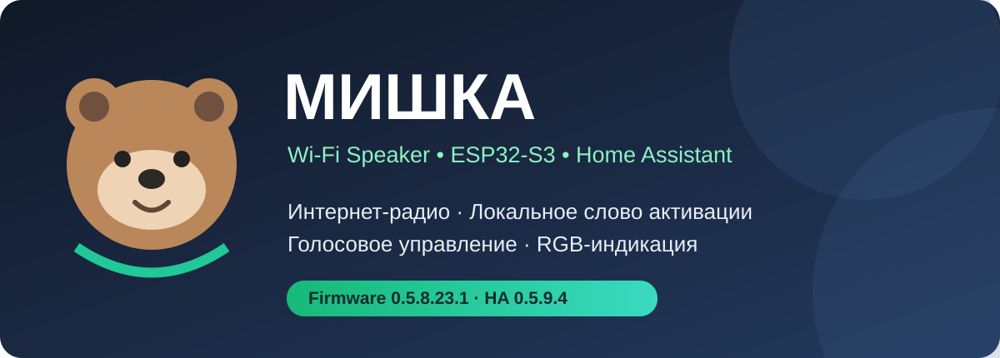
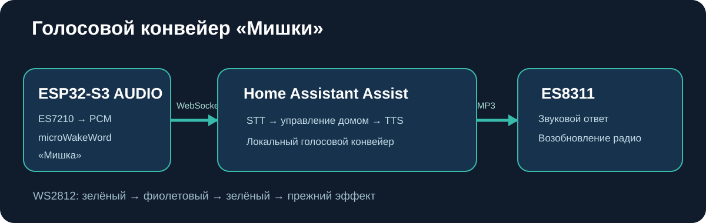

<div align="center">

# 🐻 Мишка — Wi-Fi Speaker

**Локальное голосовое управление Home Assistant и интернет-радио на ESP32-S3**

[](docs/images/mishka-banner.svg)

**Прошивка:** `v0.5.8.23.1` · **Интеграция Home Assistant:** `v0.5.9.4` · **ESP-IDF:** `5.5.6`

</div>

## Что такое «Мишка»?

«Мишка» — самостоятельная Wi-Fi-колонка на плате **Waveshare ESP32-S3 AUDIO**, которая умеет воспроизводить интернет-радио, локально обнаруживать ключевое слово **«Мишка»** через модель microWakeWord/TensorFlow Lite Micro и выполнять голосовые команды через **Home Assistant Assist**. Распознавание команды и синтез речи выполняет настроенный конвейер Home Assistant; обнаружение ключевого слова работает на самом ESP32-S3.

## Возможности

- 🎙️ Локальное обнаружение слова **«Мишка»**, аппаратный микрофон ES7210, кнопка BOOT (GPIO0) для выключения микрофона
- 🏠 Home Assistant Assist по WebSocket: STT → действие → TTS с воспроизведением на ES8311
- 📻 Интернет-радио MP3/AAC, избранные станции, громкость и пауза
- 🌈 Семь WS2812 (GPIO38): статичная подсветка, эффекты, светомузыка и временная индикация Assist
- 📱 Веб-панель настройки, OTA с подтверждением прошивки, хранение настроек в NVS
- 📡 MQTT, MQTT Discovery и пользовательская интеграция Home Assistant
- 🔊 Автоматическое приглушение/остановка радио во время диалога и восстановление воспроизведения после TTS

## Как это работает



```text
Пользователь: «Мишка, выключи ночник»
        │
        ▼
ESP32-S3: локальная модель mishka.tflite
        │ WebSocket + PCM 16 кГц
        ▼
Home Assistant Assist (STT → intent → TTS)
        │
        ▼
ESP32-S3: ES8311 → динамик → восстановление радио
```

## Фотографии и материалы проекта

Ниже будут опубликованы реальные изображения платы Waveshare ESP32-S3 AUDIO и проекта «Мишка». Фотографии откроются в полном размере при нажатии.


## Аппаратная платформа

| Компонент | Использование |
|---|---|
| Waveshare ESP32-S3 AUDIO | Основная плата, ESP32-S3 и PSRAM |
| ES7210 | Захват микрофонного аудио |
| ES8311 | Воспроизведение через I²S |
| GPIO15 | Вход I²S от ES7210 |
| GPIO16 | Выход I²S на ES8311 |
| GPIO13 / GPIO14 | Общие BCLK / WS |
| GPIO38 | Адресные WS2812 |
| BOOT / GPIO0 | Выключение / включение микрофона |

При изменении I²S нужно учитывать общие тактовые линии входа и выхода: частота микрофона следует за частотой воспроизведения.

## Световая индикация Assist

| Состояние | Цвет |
|---|---|
| Ожидание | Последний выбранный эффект |
| Обнаружено «Мишка» | Короткая зелёная вспышка |
| Прослушивание | Мягкий зелёный |
| Обработка | Фиолетовая пульсация |
| Озвучивание ответа | Зелёный |
| Ошибка | Три красных вспышки |

Индикация Assist временно перекрывает светомузыку и после ответа возвращает прежний эффект **без изменения NVS**.

## Установка

Подробности — в [руководстве по установке](docs/INSTALL_RU.md).

1. Установить **ESP-IDF 5.5.6** и собрать прошивку для `esp32s3`.
2. Первую прошивку загрузить по USB, последующие обновления — через OTA.
3. В веб-интерфейсе указать Wi-Fi, MQTT и параметры Home Assistant Assist. **Пароли и токены не добавлять в Git.**
4. Скопировать `custom_components/mishka_speaker` в `/config/custom_components/` Home Assistant и перезапустить HA.
5. В настройках Assist выбрать действующий голосовой конвейер.

## Состав проекта

- `firmware/` — прошивка ESP-IDF, аудио, радио, wake-word и веб-панель
- `custom_components/mishka_speaker/` — пользовательская интеграция Home Assistant
- `docs/` — установка, архитектура, схемы и изображения
- `docs/images/` — иллюстрации проекта

## Проверенное состояние

**6 ноября 2026:** подтверждены авторизация Home Assistant WebSocket, распознавание голосовых команд, воспроизведение TTS, управление ночником, восстановление радио, переключение световых состояний, MQTT и сокращённое журналирование. Это не означает, что каждый сценарий протестирован на каждом устройстве.

### Известные ограничения

- Акустическое эхоподавление **AEC пока не реализовано**.
- Частота RX микрофона изменяется вместе с общими тактовыми линиями I²S.
- Не публикуйте `sdkconfig`, дампы NVS, ключи и персональные настройки без проверки.
- Если HA возвращает WebSocket HTTP 403, проверьте `/config/ip_bans.yaml` и причину блокировки IP.

---

**Автор:** [asustek1978](https://github.com/asustek1978) · Проект домашней колонки «Мишка».
